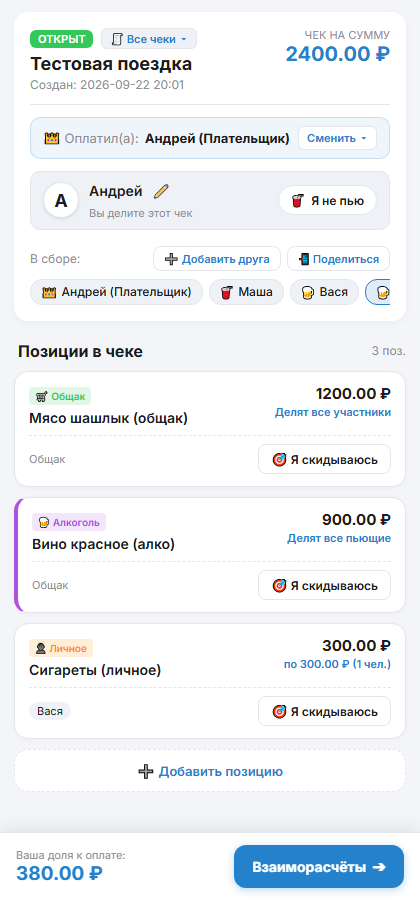
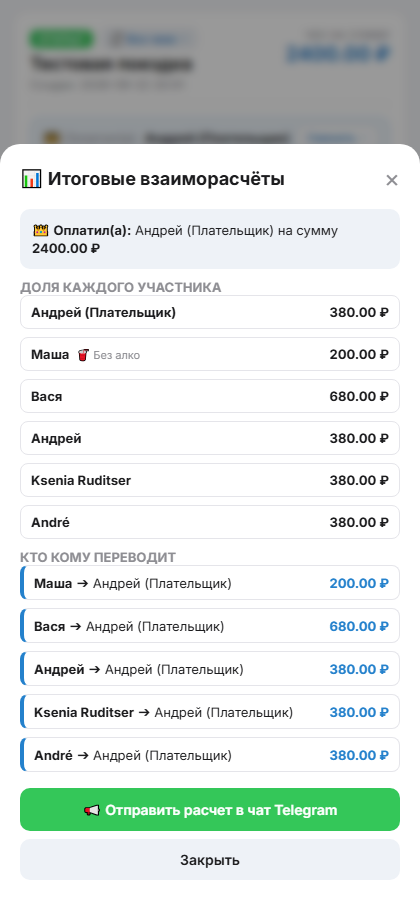
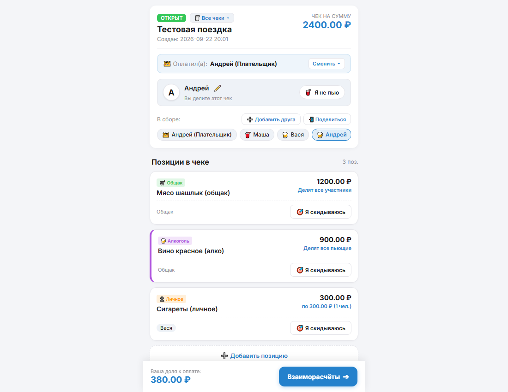
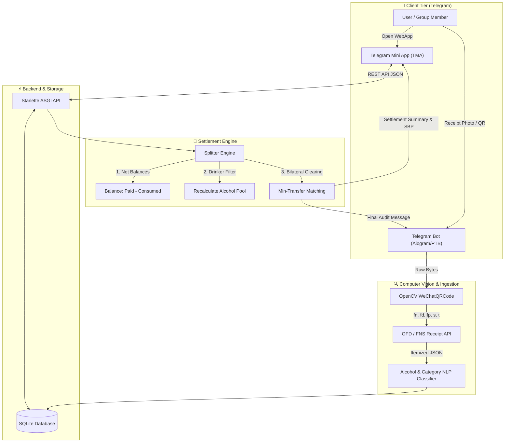

# 🧾 SplitBill Telegram Mini App & Bot

<div align="center">

[](https://www.python.org/)
[](https://core.telegram.org/bots/webapps)
[](https://www.starlette.io/)
[](https://opencv.org/)
[](https://www.sqlite.org/)
[](https://sbp.nspk.ru/)
[](LICENSE)

**An intelligent FinTech ecosystem for transparent restaurant bill splitting inside Telegram: computer vision for fiscal QR codes, seamless WebApp Mini App, automated alcohol exclusion, and graph debt settlement minimization.**

[🇷🇺 Русский](README.md) | [🇬🇧 English](README.en.md)

</div>

---

## 📸 Visual Showcase

<div align="center">
  <table>
    <tr>
      <td width="33%" align="center">
        <b>📱 Telegram Mini App (Items & Claims)</b><br><br>
        
      </td>
      <td width="33%" align="center">
        <b>⚖️ Debt Settlement & Minimization Modal</b><br><br>
        
      </td>
      <td width="33%" align="center">
        <b>💻 Responsive Desktop Experience</b><br><br>
        
      </td>
    </tr>
  </table>
</div>

---

## 🎯 Problem Statement & Solution

Dining out with friends or group gatherings often turn into an awkward, chaotic financial hassle:
* Someone abstained from costly alcohol or cocktails, but the check gets split "equally by head count".
* Certain guests ordered dedicated premium dishes, while snacks and appetizers were shared among four people.
* At the end of the evening, a tangled web of bilateral debts emerges, requiring multiple interbank transfer fees and manual math.

**SplitBill** solves this in under 15 seconds:
1. **The payer snaps a photo of the receipt's fiscal QR code** directly in the Telegram bot.
2. The server instantly parses fiscal metadata (`fn`, `fd`, `fp`, sum, timestamp) and queries the official fiscal data operator (OFD / FNS) for itemized line positions.
3. Group participants open the **Telegram Mini App (WebApp)** directly within chat, claiming their items with a single tap.
4. Non-drinkers tap `🥤 I don't drink` — the system automatically redistributes all bar and alcohol items strictly among drinkers.
5. A greedy bilateral clearing algorithm **minimizes the number of P2P transfers** (from $O(N^2)$ down to at most $N-1$) and generates ready-to-use Faster Payment System (SBP) deep links for instant settlement.

---

## 🚀 1. Architecture & Functional Modules

### 1.1 Computer Vision & Fiscal Parsing (`receipt_parser.py`)
- **OpenCV WeChatQRCode & QRCodeDetector:** Multi-stage computer vision pipeline optimized for crumpled, poorly lit, or curved paper receipts.
- **Fiscal Metadata Extraction:** Robust regex parsers extract fiscal storage ID (`fn`), fiscal document ID (`fd`), fiscal signature (`fp`), total sum (`s`), and ISO timestamp (`t`).
- **Official OFD/FNS API Integration:** Pulls verified itemized line items, unit quantities, item prices, and VAT amounts.
- **Heuristic NLP Classifier:** Automatically tags incoming items as alcohol, personal items (tobacco), or shared dishes using keyword taxonomies and exclusion rules (`non-alcoholic`, `0.0`, `б/а`).

### 1.2 Interactive Telegram Mini App (`frontend/` + `api.py`)
- Zero-dependency Single Page Application (Vanilla ES6+, Modern CSS Custom Properties, Flexbox/Grid).
- Seamless theme synchronization with Telegram client color schemes (`Telegram.WebApp.themeParams`).
- Optimistic UI updates ensuring immediate tactile feedback without waiting for network round-trips.
- Concurrent multi-user claim synchronization and real-time live total calculation.

### 1.3 Smart Split & Alcohol Exemption Logic
- **Shared Pool ("Общак"):** Distributed equally among all active participants in the bill.
- **Alcohol Exemption ("I don't drink"):** Alcoholic items are dynamically filtered out of non-drinkers' shares and balanced solely among active drinkers.
- **Custom Multi-User Claims:** Any specific item can be claimed exclusively by one person or divided among any subset of participants (e.g. sharing a pizza between 3 people).

### 1.4 Graph Debt Settlement Algorithm (`splitter.py`)
Instead of quadratic peer-to-peer payments, the engine runs bilateral net clearing:
1. Computes each participant's net balance:
   $$\text{Net}_i = \text{Paid}_i - \text{Consumed}_i$$
2. Segregates users into two pools: **Debtors** ($\text{Net} < 0$) and **Creditors** ($\text{Net} > 0$).
3. A greedy matching algorithm iteratively pairs the largest debtor with the largest creditor until all obligations are cleared in minimal steps:
   $$\text{Transfers} \le N - 1$$

### 1.5 Banking & SBP Integration
- Supports payer's banking requisites: phone number and receiving bank (Alfa-Bank, T-Bank, Sber, VTB, etc.).
- Prepares 1-click SBP payment links and pre-formatted clipboard transfer instructions.

---

## 🏗 2. System Architecture



---

## 🛠 3. Technology Stack

| Component | Technology | Rationale |
| :--- | :--- | :--- |
| **Backend Core** | `Python 3.11+`, `Starlette`, `Uvicorn` | Asynchronous ASGI server delivering microsecond latency |
| **Telegram Bot** | `python-telegram-bot` / `aiohttp` | Handling webhooks, photo uploads, and group inline keyboards |
| **Computer Vision** | `OpenCV (cv2)`, `wechat_qrcode`, `NumPy` | Industrial-grade detection of damaged receipt QR codes |
| **Receipt Ingestion** | `Requests`, `Taxcom / FNS REST API` | Legal itemized fiscal data extraction |
| **Frontend** | `HTML5`, `Vanilla ES6+`, `CSS3 Variables` | Fast, lightweight Mini App running inside iOS/Android/Desktop Telegram |
| **Database** | `SQLite3` (relational with cascade deletes) | ACID transactions for bills, items, claims, and users |
| **Algorithm** | Greedy Bilateral Net Settlement | Minimizes P2P payments from $O(N^2)$ to $O(N)$ |

---

## 📂 4. Repository Structure

```text
11-split-bill-telegram-app/
├── api.py                  # Starlette REST API endpoints for Telegram Mini App
├── bot.py                  # Telegram bot service (photo intake, commands, inline UI)
├── config.py               # Environment configuration and secrets management
├── database.py             # SQLite persistence layer (CRUD for bills, users, claims)
├── receipt_parser.py       # OpenCV QR decoder, OFD/FNS integration, NLP filters
├── splitter.py             # Split math engine and debt minimization graph algorithm
├── run_all.py              # Single-command orchestrator for both API and Bot
├── tunnel.py               # Automated HTTPS tunneling via ngrok or cloudflared
├── test_api.py             # Unit tests for REST API endpoints
├── test_system.py          # End-to-end integration test suite
├── requirements.txt        # Python dependency manifest
├── .env.example            # Environment variables template
├── frontend/               # Telegram Mini App client
│   ├── index.html          # WebApp markup
│   ├── app.js              # Reactive UI state and Telegram WebApp SDK bindings
│   └── style.css           # Responsive styling with light/dark theme adaptation
└── docs/images/            # High-resolution screenshots and UI visual assets
    ├── splitbill_app_main.png
    ├── splitbill_settlements_modal.png
    └── splitbill_desktop_overview.png
```

---

## ⚙️ 5. Quickstart & Deployment

### 5.1 Clone & Install Dependencies
```bash
git clone https://github.com/Andrew123485/split-bill-bot.git
cd split-bill-bot

python -m venv venv
# Activate environment:
# Windows:
venv\Scripts\activate
# Linux/macOS:
source venv/bin/activate

pip install -r requirements.txt
```

### 5.2 Environment Configuration
Create your `.env` configuration file from the template:
```bash
cp .env.example .env
```
Populate `.env` with your credentials:
```ini
# Bot token from @BotFather
BOT_TOKEN=123456789:ABCdefGHIjklMNOpqrsTUVwxyz

# Fiscal receipt verification API key (proverkacheka.com)
PROVERKACHEKA_TOKEN=your_proverkacheka_api_token_here

# Server settings
PORT=8080
WEBAPP_URL=https://your-public-domain-or-tunnel.com
```

### 5.3 Local Execution
Launch both the REST API and Telegram Bot service concurrently:
```bash
python run_all.py
```
The server will bind to `http://localhost:8080`, and the SQLite database schema will initialize automatically.

---

## 📡 6. REST API Endpoints

| Method | Endpoint | Description |
| :--- | :--- | :--- |
| `GET` | `/api/bill/{bill_id}` | Fetch complete bill metadata, line items, claims, and participants |
| `POST` | `/api/bill/{bill_id}/join` | Register a new user into an active bill |
| `POST` | `/api/bill/{bill_id}/claim` | Toggle an item claim for a specific user |
| `POST` | `/api/bill/{bill_id}/toggle-alcohol` | Toggle `🥤 I don't drink` alcohol exemption status |
| `GET` | `/api/bill/{bill_id}/calculate` | Run split calculation and optimal debt transfers |
| `POST` | `/api/bill/{bill_id}/close` | Finalize bill and dispatch summary report to Telegram chat |

---

## 📊 7. Debt Settlement Demonstration

Consider a restaurant bill of **10,000 ₽** paid upfront by Andrey:
- **Andrey** paid `10,000 ₽` (Consumed: `2,500 ₽`, Net Balance: `+7,500 ₽`)
- **Boris** was a non-drinker (Consumed: `1,200 ₽`, Net Balance: `-1,200 ₽`)
- **Victor** ordered steak & premium wine (Consumed: `3,800 ₽`, Net Balance: `-3,800 ₽`)
- **Daria** had cocktails & dessert (Consumed: `2,500 ₽`, Net Balance: `-2,500 ₽`)

**Without Clearing:** Everyone owes multiple fractions for each shared dish.  
**With SplitBill:** Exactly **3 clean P2P transfers** directly to the payer:
1. `Victor ➔ Andrey`: **3,800 ₽**
2. `Daria ➔ Andrey`: **2,500 ₽**
3. `Boris ➔ Andrey`: **1,200 ₽**

---

## 📄 License

This project is licensed under the [MIT License](LICENSE). Built for automated social accounting and modern FinTech integrations.
