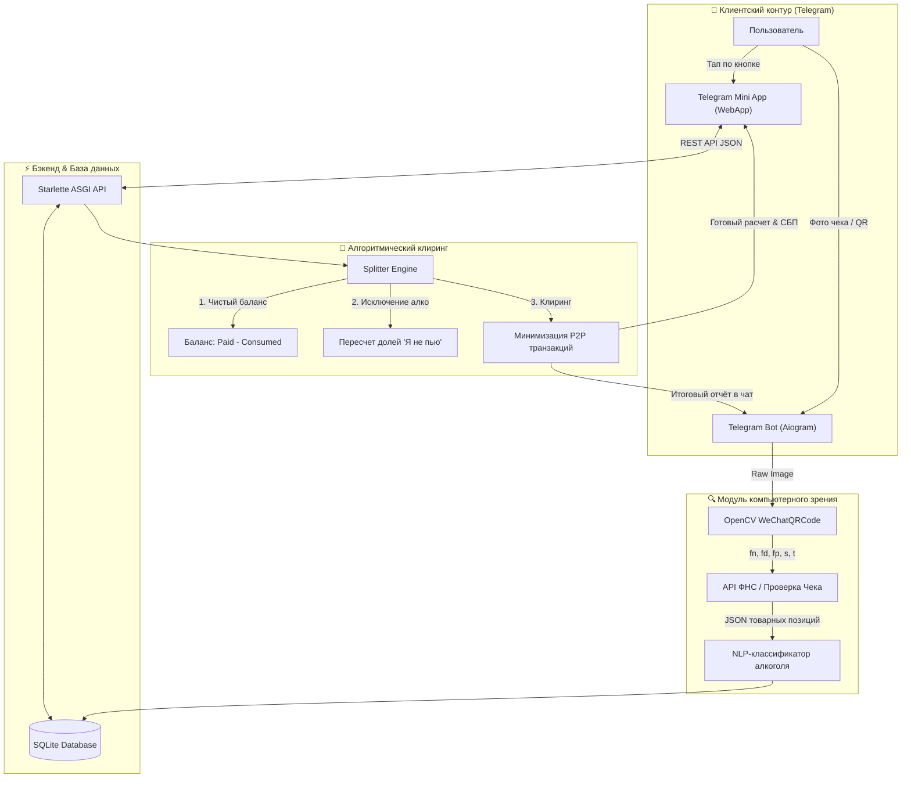

# 🧾 SplitBill Telegram Mini App & Bot

<div align="center">

[](https://www.python.org/)
[](https://core.telegram.org/bots/webapps)
[](https://www.starlette.io/)
[](https://opencv.org/)
[](https://www.sqlite.org/)
[](https://sbp.nspk.ru/)
[](LICENSE)

**Интеллектуальная FinTech-экосистема для прозрачного разделения ресторанных чеков в Telegram: компьютерное зрение для фискальных QR-кодов, бесшовное WebApp-приложение, исключение алкоголя и графовая минимизация P2P-переводов.**

[🇷🇺 Русский](README.md) | [🇬🇧 English](README.en.md)

</div>

---

## 📸 Галерея интерфейса / Visual Showcase

<div align="center">
  <table>
    <tr>
      <td width="33%" align="center">
        <b>📱 Telegram Mini App (Позиции и участники)</b><br><br>
        
      </td>
      <td width="33%" align="center">
        <b>⚖️ Итоговый расчет и взаимозачет долгов</b><br><br>
        
      </td>
      <td width="33%" align="center">
        <b>💻 Адаптивный десктопный режим</b><br><br>
        
      </td>
    </tr>
  </table>
</div>

---

## 🎯 Проблема и решение

В компаниях друзей совместные походы в рестораны или бары традиционно сопровождаются неудобным ручным расчетом:
* Кто-то не пил дорогой алкоголь, но счет делят «поровну на всех».
* Кто-то заказал отдельное блюдо только себе, а закуски делились на четверых.
* В конце вечера возникает запутанная паутина взаимных долгов (каждый должен каждому), требующая десятков комиссионных переводов.

**SplitBill** решает эту проблему за 15 секунд:
1. **Плательщик фотографирует фискальный QR-код на чеке** в Telegram-боте.
2. Сервер мгновенно считывает позиции и цены через базу ФНС / ОФД (ФН, ФД, ФП).
3. Участники открывают **Telegram Mini App (WebApp)** прямо внутри диалога, отмечают свои позиции в один клик.
4. Те, кто не употреблял алкоголь, нажимают одну кнопку `🥤 Я не пью` — система автоматически вычитает винную карту из их чека и честно распределяет её только между пьющими.
5. Жадный алгоритм клиринга **минимизирует число переводов** (из $N \times (N-1)$ до максимум $N-1$) и генерирует готовые реквизиты СБП для оплаты в один тап.

---

## 🚀 1. Архитектура и функциональные модули

### 1.1 Компьютерное зрение и фискальный парсинг (`receipt_parser.py`)
- **OpenCV WeChatQRCode & QRCodeDetector:** многоуровневый алгоритм распознавания QR-кодов на мятых, плохо освещенных или изогнутых бумажных чеках.
- **Экстракция параметров ФНС:** регулярные выражения извлекают фискальный номер (`fn`), фискальный документ (`fd`), фискальный признак (`fp`), сумму (`s`) и дату/время (`t`).
- **Интеграция с ФНС / Проверка Чека API:** автоматическая выгрузка полного списка товарных позиций, количества, цен и НДС.
- **Эвристический NLP-классификатор:** автоматическое определение категорий продуктов (алкоголь, табак, безалкогольные блюда) по базе ключевых слов и стоп-слов (`б/а`, `0.0`, `нулевка`).

### 1.2 Интерактивный Telegram Mini App (`frontend/` + `api.py`)
- Полнофункциональный SPA без тяжелых внешних фреймворков (Vanilla JS, Modern CSS Variables, CSS Grid/Flexbox).
- Нативная адаптация под цветовую палитру Telegram (`Telegram.WebApp.themeParams`).
- Мгновенный отклик интерфейса с оптимистичным обновлением состояния (Optimistic UI) и защитой от сетевых задержек.
- Динамический расчет баланса в реальном времени при выборе блюд несколькими пользователями одновременно.

### 1.3 Логика справедливого распределения («Я не пью» & Совместные блюда)
- **Категория «Общак»:** делится поровну между всеми участниками чека.
- **Категория «Алкоголь»:** автоматически делится строго среди тех участников, у которых выключен флаг `🥤 Я не пью`. Если все отметили флаг, алгоритм защищенно распределяет сумму между всеми.
- **Индивидуальные и групповые отметки:** любое блюдо может быть закреплено за одним конкретным человеком или разделено между произвольной группой (например, пицца на троих).

### 1.4 Графовая минимизация взаимных расчетов (`splitter.py`)
Вместо хаотичных переводов между всеми участниками алгоритм сводит расчет к задаче клиринга:
1. Вычисляется чистый нетто-баланс каждого участника:
   $$\text{Net}_i = \text{Paid}_i - \text{Consumed}_i$$
2. Формируются два пула: **Должники** ($\text{Net} < 0$) и **Кредиторы** ($\text{Net} > 0$).
3. Жадный алгоритм сопоставляет максимального должника с максимальным кредитором, погашая обязательства за минимальное число транзакций:
   $$\text{Transfers} \le N - 1$$

### 1.5 Интеграция с платежами и СБП
- Поддержка реквизитов плательщика: номер телефона, привязанный банк (Альфа-Банк, Т-Банк, Сбер, ВТБ и др.).
- Генерация платежных инструкций и deeplink для перехода в банковское приложение без ручного набора номера и суммы.

---

## 🏗 2. Архитектура системы



---

## 🛠 3. Стек технологий

| Компонент | Технологии | Назначение |
| :--- | :--- | :--- |
| **Backend Core** | `Python 3.11+`, `Starlette`, `Uvicorn` | Высокопроизводительный асинхронный ASGI веб-сервер |
| **Telegram Bot** | `python-telegram-bot` / `aiohttp` | Обработка команд, фотографий чеков, inline-интерфейсы |
| **Computer Vision** | `OpenCV (cv2)`, `wechat_qrcode`, `NumPy` | Детекция и декодирование поврежденных фискальных QR-кодов |
| **Receipt Extraction** | `Requests`, `Taxcom / FNS REST API` | Получение юридически значимого состава фискального чека |
| **Frontend** | `HTML5`, `Vanilla ES6+`, `Modern CSS3` | Легковесный Mini App, работающий нативно внутри Telegram iOS/Android/Desktop |
| **Database** | `SQLite3` (структурированный с каскадным удалением) | Реляционное хранилище чеков, позиций, участников и отметок |
| **Algorithmics** | Greedy Bilateral Clearing Network | Алгоритм минимизации числа P2P-переводов |

---

## 📂 4. Структура проекта

```text
11-split-bill-telegram-app/
├── api.py                  # Starlette REST API (эндпоинты для Telegram Mini App)
├── bot.py                  # Telegram-бот (прием фото чеков, команды, inline-кнопки)
├── config.py               # Конфигурация окружения, токены и порты
├── database.py             # Слой работы с SQLite (CRUD чеков, участников, позиций)
├── receipt_parser.py       # OpenCV декодер QR-кодов, интеграция с ФНС, NLP-фильтры
├── splitter.py             # Математический движок сплита и графовый клиринг долгов
├── run_all.py              # Оркестратор одновременного запуска API и бота
├── tunnel.py               # Автоматический проброс HTTPS-туннелей (ngrok / cloudflared)
├── test_api.py             # Модульные тесты эндпоинтов API
├── test_system.py          # Комплексные сквозные тесты системы расчетов
├── requirements.txt        # Зависимости Python
├── .env.example            # Шаблон переменных окружения
├── frontend/               # Telegram Mini App
│   ├── index.html          # Разметка WebApp
│   ├── app.js              # Реактивная логика UI, взаимодействие с Telegram WebApp SDK
│   └── style.css           # Адаптивные стили с поддержкой темной/светлой темы
└── docs/images/            # Скриншоты и визуальные материалы
    ├── splitbill_app_main.png
    ├── splitbill_settlements_modal.png
    └── splitbill_desktop_overview.png
```

---

## ⚙️ 5. Установка и запуск

### 5.1 Клонирование и установка зависимостей
```bash
git clone https://github.com/Andrew123485/split-bill-bot.git
cd split-bill-bot

python -m venv venv
# Активация:
# Windows:
venv\Scripts\activate
# Linux/macOS:
source venv/bin/activate

pip install -r requirements.txt
```

### 5.2 Настройка переменных окружения
Создайте файл `.env` на основе `.env.example`:
```bash
cp .env.example .env
```
Заполните параметры в `.env`:
```ini
# Токен бота из @BotFather
BOT_TOKEN=123456789:ABCdefGHIjklMNOpqrsTUVwxyz

# Токен API сервиса проверки чеков (proverkacheka.com)
PROVERKACHEKA_TOKEN=your_proverkacheka_api_token_here

# Настройки сервера
PORT=8080
WEBAPP_URL=https://your-public-domain-or-tunnel.com
```

### 5.3 Запуск локально
Для запуска связки API + Telegram Bot одной командой:
```bash
python run_all.py
```
Сервер запустится по адресу `http://localhost:8080`, база данных SQLite инициализируется автоматически.

---

## 📡 6. Спецификация REST API

| Метод | Эндпоинт | Описание |
| :--- | :--- | :--- |
| `GET` | `/api/bill/{bill_id}` | Получение полной информации о чеке, позициях и участниках |
| `POST` | `/api/bill/{bill_id}/join` | Присоединение нового участника к разделению счета |
| `POST` | `/api/bill/{bill_id}/claim` | Прикрепление/открепление пользователя от конкретной позиции |
| `POST` | `/api/bill/{bill_id}/toggle-alcohol` | Переключение статуса `🥤 Я не пью` |
| `GET` | `/api/bill/{bill_id}/calculate` | Запуск алгоритма расчета долей и клиринга переводов |
| `POST` | `/api/bill/{bill_id}/close` | Закрытие чека и публикация итогового отчета в чат |

---

## 📊 7. Пример работы алгоритма клиринга

Представим посиделку из 4 человек со счетом **10 000 ₽**, оплаченным Андреем:
- **Андрей** оплатил `10 000 ₽` (Потребление: `2 500 ₽`, Сальдо: `+7 500 ₽`)
- **Борис** не пил алкоголь (Потребление: `1 200 ₽`, Сальдо: `-1 200 ₽`)
- **Виктор** заказывал стейк и пил вино (Потребление: `3 800 ₽`, Сальдо: `-3 800 ₽`)
- **Дарья** пила вино и брала десерт (Потребление: `2 500 ₽`, Сальдо: `-2 500 ₽`)

**Без клиринга:** каждый участник должен был бы совершать раздельные переводы за разные блюда.  
**С алгоритмом SplitBill:** ровно **3 перевода**, напрямую покрывающие сальдо плательщика:
1. `Виктор ➔ Андрей`: **3 800 ₽**
2. `Дарья ➔ Андрей`: **2 500 ₽**
3. `Борис ➔ Андрей`: **1 200 ₽**

---

## 📄 Лицензия

Проект распространяется под открытой лицензией [MIT](LICENSE). Разработано для автоматизации повседневных расчетов и интеграции с современными FinTech-сервисами.
